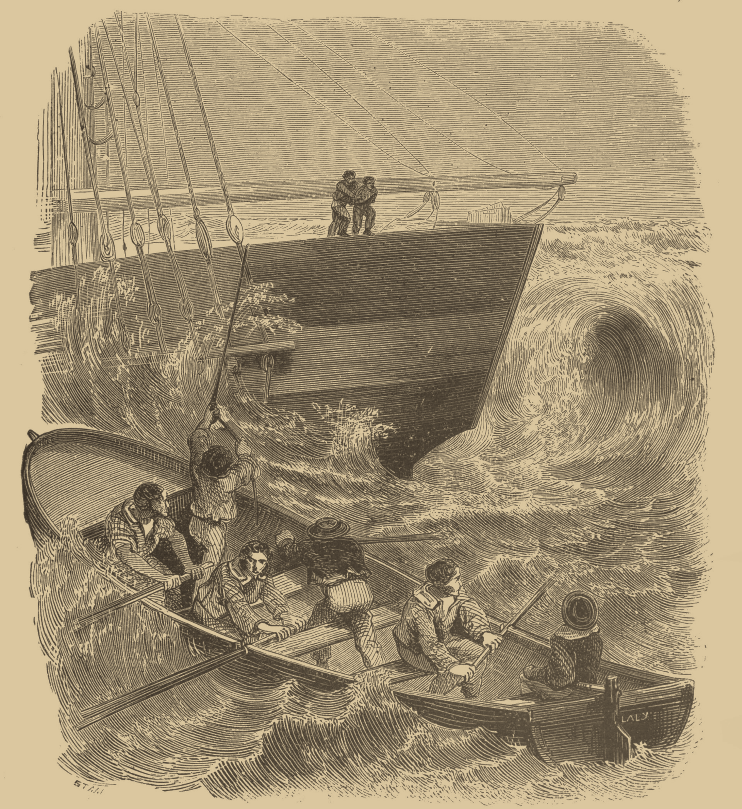

My favourite book I've read so far; I really loved it! It's the reason I first found an interest in sailing and ships.

The book is quite long, around 300k words, meaning you get plenty of time to really get absorbed into the story. One characteristic of old books is that they will just go into such unexpected detail, and write a novelette on the back story of one side character which isn't even pivotal to the story. I guess this is why people read abridged versions, but I think you'd be missing out! Just embrace the change of pace and settle into the story.

Another characteristic of the book is that it has a narrator speaking to you. I feel like this isn't really a thing anymore with books and it's very interesting, I'll definitely do that when or if I get around to writing a novel of my own.

I read the public domain translation of the book, and while it was sufficient, I did find it quite hard to follow at times, there are some more recent and more easily readable translations available and I definitely recommend those. It won't completely change the vibe of it all, but it will make it easier to understand the story.

Sometimes when I am thinking about the theme of struggle and perseverance I will think of this book, and draw inspiration from Dantès, which is curious considering it is a fictional book after all. But do not fall into the trap that fictional literature cannot be good for the mind and soul. Fictional media is describing the human experience after all. Written by humans, for humans, centering around human themes and stories. I think a healthy media diet definitely includes fictional works as well as other kinds if you want to be a well rounded human.

Next I'd like to continue reading Les Misérables, it's seeming like it will be a similar experience so far.
